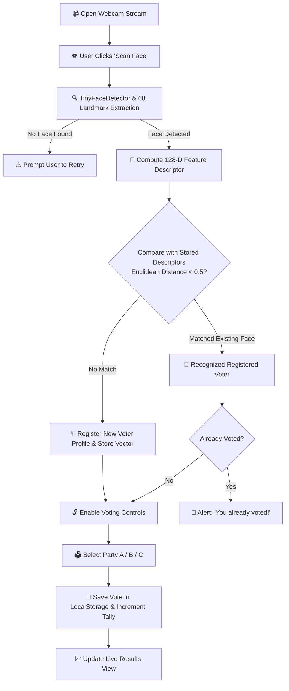

# 🗳️ Face Recognition Online Voting System

[](https://developer.mozilla.org/en-US/docs/Web/JavaScript)
[](https://github.com/justadudewhohacks/face-api.js)
[](https://developer.mozilla.org/en-US/docs/Web/HTML)
[](https://developer.mozilla.org/en-US/docs/Web/CSS)
[](LICENSE)

A lightweight, privacy-focused, and intelligent **Biometric Online Voting System** that leverages client-side deep learning and computer vision to verify voter identity and prevent duplicate votes.

Powered by [face-api.js](https://github.com/justadudewhohacks/face-api.js) (built on TensorFlow.js), this web application performs real-time face detection, 68-point facial landmark extraction, and 128-dimensional biometric descriptor matching entirely in the browser.

---

## 📌 Table of Contents

- [✨ Key Features](#-key-features)
- [🧠 How It Works (Workflow & Architecture)](#-how-it-works-workflow--architecture)
- [📂 Project Structure](#-project-structure)
- [🚀 Quick Start & Installation](#-quick-start--installation)
- [📖 Usage Guide](#-usage-guide)
- [⚙️ Technical Specifications](#️-technical-specifications)
- [🔧 Customization & Configuration](#-customization--configuration)
- [❓ Troubleshooting & FAQs](#-troubleshooting--faqs)
- [🔮 Future Roadmap](#-future-roadmap)
- [📄 License](#-license)

---

## ✨ Key Features

- **⚡ Real-Time Face Detection**: Utilizes lightweight `TinyFaceDetector` for fast frame analysis via webcam stream.
- **🔒 Biometric Vector Matching**: Computes 128-dimensional feature vectors with Euclidean distance matching (`threshold < 0.5`) to reliably recognize unique faces.
- **🚫 Anti-Duplicate Vote Prevention**: Strict one-person-one-vote rule enforced by linking each user's facial signature to their voting state.
- **💻 100% Client-Side Execution**: No video streams or face images are sent to an external server; all biometric computations run locally in the browser.
- **📊 Real-Time Live Results**: Dynamically tallies and updates poll results after each valid submission.
- **🎨 Glassmorphic Modern UI**: Responsive card layout with frosted-glass backdrop blur, glowing action buttons, and live camera feed.

---

## 🧠 How It Works (Workflow & Architecture)



### Biometric Recognition Pipeline:
1. **Face Detection**: `faceapi.nets.tinyFaceDetector` locates the boundary box of the user's face in the video frame.
2. **Landmark Extraction**: `faceapi.nets.faceLandmark68Net` extracts 68 unique facial reference points.
3. **Descriptor Generation**: `faceapi.nets.faceRecognitionNet` outputs a 128-value floating-point array (vector representation).
4. **Distance Metric**: `faceapi.euclideanDistance(storedDescriptor, currentDescriptor)` checks similarity:
   - **Distance < 0.5**: Verified as the same individual.
   - **Distance ≥ 0.5**: Registered as a new voter.

---

## 📂 Project Structure

```text
online-voting/
│
├── 📁 models/                                   # Pre-trained deep learning weights
│   ├── face_landmark_68_model-shard1
│   ├── face_landmark_68_model-weights_manifest.json
│   ├── face_recognition_model-shard1
│   ├── face_recognition_model-shard2
│   ├── face_recognition_model-weights_manifest.json
│   ├── tiny_face_detector_model-shard1
│   └── tiny_face_detector_model-weights_manifest.json
│
├── 📁 image/                                    # UI Assets & Backgrounds
│   └── voting-bg.jpg
│
├── 📄 index.html                                # HTML5 markup & video viewport
├── 📄 style.css                                 # Glassmorphism design & animations
├── 📄 script.js                                 # WebRTC, face-api pipeline & voting logic
├── 📄 .gitattributes                            # Git LFS / line-ending settings
└── 📄 README.md                                 # Project documentation
```

---

## 🚀 Quick Start & Installation

> [!IMPORTANT]
> Because the browser security model requires `HTTP`/`HTTPS` to access the camera (`getUserMedia`) and fetch neural network weights from `./models/`, you **must run the project using a local web server** rather than double-clicking `index.html` (which opens via `file://`).

### Method 1: VS Code Live Server (Easiest)
1. Open the project folder in **VS Code**.
2. Install the **Live Server** extension (`ritwickdey.LiveServer`).
3. Right-click `index.html` and select **Open with Live Server**.

### Method 2: Node.js (`npx serve` or `http-server`)
```bash
# Using npx (no install required)
npx serve .

# OR using http-server
npx http-server -p 8080
```
Open [http://localhost:3000](http://localhost:3000) or [http://localhost:8080](http://localhost:8080) in your browser.

### Method 3: Python Built-in Server
```bash
# Python 3.x
python -m http.server 8000
```
Open [http://localhost:8000](http://localhost:8000) in your browser.

---

## 📖 Usage Guide

1. **Grant Camera Permissions**: Allow webcam access when prompted by your browser.
2. **Scan Face**:
   - Align your face in front of the camera viewport.
   - Click the **Scan Face** button.
   - If first time: Creates a new unique voter ID (e.g., `user_1728574890123`).
   - If returning: Identifies your registered face.
3. **Cast Your Vote**:
   - Click your desired candidate button (**Party A**, **Party B**, or **Party C**).
   - A confirmation alert will appear and the vote will be logged.
4. **Duplicate Vote Check**:
   - If the same user attempts to scan their face and vote a second time, an alert will block them: *"You already voted!"*.
5. **View Live Results**:
   - The tally updates in real time under the **Live Results** card.

---

## ⚙️ Technical Specifications

| Component | Technology / Detail |
| :--- | :--- |
| **Frontend Core** | HTML5, CSS3, Modern JavaScript (ES6+ async/await) |
| **Computer Vision Engine** | [face-api.js](https://github.com/justadudewhohacks/face-api.js) v0.22.2 |
| **Neural Net Models** | `TinyFaceDetector`, `FaceLandmark68Net`, `FaceRecognitionNet` |
| **Face Match Metric** | Euclidean Distance ($\sqrt{\sum_{i=1}^{n} (u_i - v_i)^2}$) with `0.5` cutoff |
| **Media Capture** | WebRTC `navigator.mediaDevices.getUserMedia` |
| **Local Storage** | Browser `localStorage` (`faces`, `results`, user-specific vote keys) |
| **Styling** | Glassmorphism, CSS Backdrop Filters, Flexbox layout |

---

## 🔧 Customization & Configuration

You can customize the detection sensitivity, threshold, or candidate list by editing `script.js`:

### Adjusting Face Recognition Tolerance
```javascript
// In script.js line 88
// Lower value = Stricter match (fewer false positives)
// Higher value = More lenient match (allows minor lighting / expression differences)
if (distance < 0.5) {  // Default: 0.5 (recommended range: 0.45 - 0.55)
    matchedUser = face.id;
    break;
}
```

### Adjusting Face Detector Settings
```javascript
// In script.js line 66
new faceapi.TinyFaceDetectorOptions({
    inputSize: 320,        // Options: 128, 160, 224, 320, 416, 512, 608
    scoreThreshold: 0.3    // Confidence minimum (0.1 to 0.9)
})
```

### Resetting Voter Data / Polling Data
To clear previous votes during testing, open your browser's Developer Console (<kbd>F12</kbd> -> **Console**) and execute:
```javascript
localStorage.clear();
location.reload();
```

---

## ❓ Troubleshooting & FAQs

### 1. `face-api.js not loaded!` or models fail to load
- Ensure you are running the project through an HTTP server (`http-server`, `serve`, or `Live Server`) and not via `file://`.
- Verify the `models/` directory contains all 7 required model and manifest files.

### 2. "Camera access denied!"
- Check your browser site permissions and ensure camera permissions are granted.
- Ensure no other application (like Zoom, Teams, or OBS) is locking the webcam.

### 3. Face is not recognized consistently
- Make sure your face is well-lit and facing straight toward the camera.
- You can tune the `distance` threshold in `script.js` from `0.5` to `0.55`.

---

## 🔮 Future Roadmap

- [ ] **Liveness Detection**: Blink / head-turn verification to prevent photo and spoof attacks.
- [ ] **Backend Integration**: Node.js / Express REST API with MongoDB / PostgreSQL.
- [ ] **Admin Dashboard**: Real-time analytical charts (Chart.js), voter turnout metrics, and party configuration.
- [ ] **Blockchain Ledger**: Immutable decentralized vote verification using Ethereum / Polygon smart contracts.
- [ ] **Multi-Camera & Mobile Optimization**: Enhanced responsive UI and rear-camera switching.

---

## 📄 License

This project is open source and available under the [MIT License](LICENSE).

---

<p align="center">
  Made with ❤️ for secure, transparent, and intelligent biometric voting systems.
</p>
